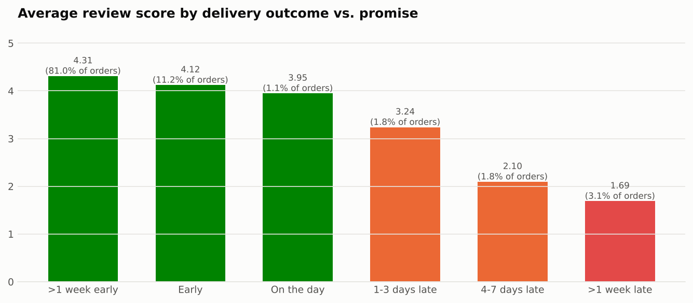
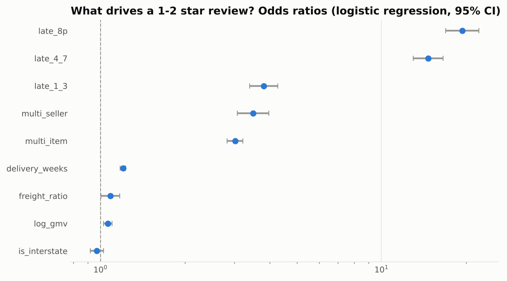
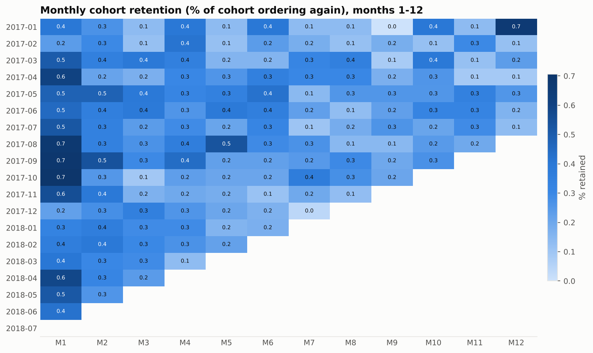
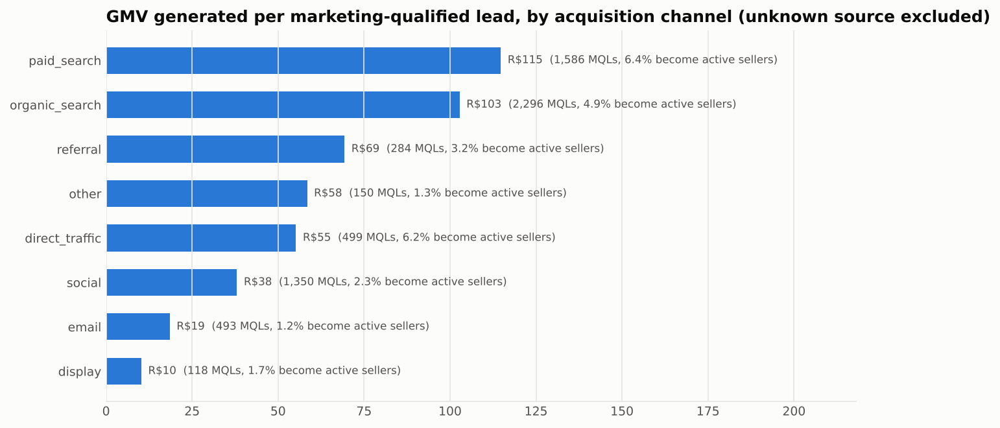
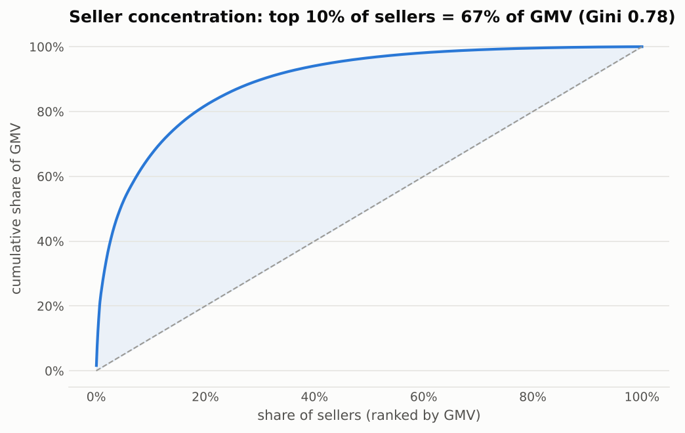
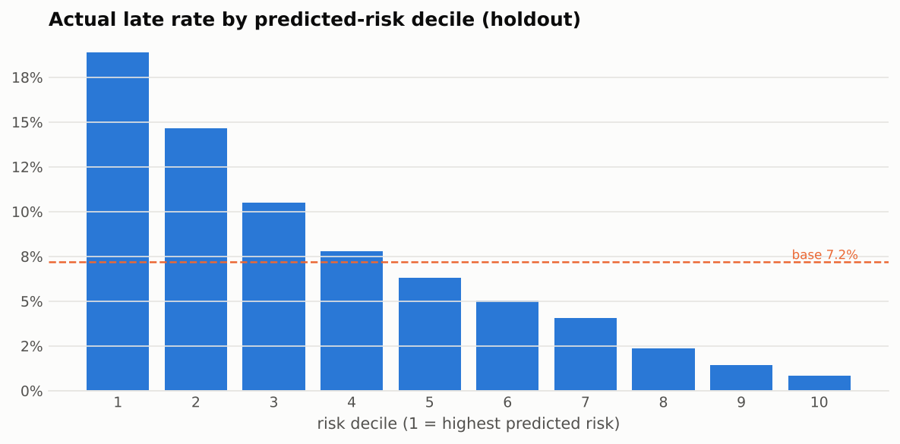

# Commerce Intelligence Platform

**End-to-end analytics on a real marketplace: 99K orders, 3K sellers, 8K B2B leads → a dbt + DuckDB warehouse, 12 analysis modules, 2 predictive models, a forecast backtest, an experiment plan, and BI-ready exports for Tableau and Power BI.**

[](.github/workflows/ci.yml)


> **Live dashboard:** `reports/dashboard.html` (also served from `docs/index.html` via GitHub Pages) · **Walkthrough notebook:** [`notebooks/commerce_intelligence_walkthrough.ipynb`](notebooks/commerce_intelligence_walkthrough.ipynb) · **Rebuild everything:** `make all` (~2 min)

---

## The business question

Olist is a Brazilian marketplace that connects small sellers to large e-commerce storefronts. The public dataset (Kaggle, 2016-2018) covers every order, item, payment, review, customer and seller, plus a companion dataset of the **B2B marketing funnel** that recruited those sellers. The question this project answers for a Head of Marketplace:

**Where is growth coming from, what is quietly destroying it, and what should we do next quarter - with the evidence to back each call?**

## Headline findings (Jan-2017 → Jul-2018, complete months)

| | Metric | Value |
|---|---|---|
| Scale | GMV · orders · customers · active sellers | **R$14.8M · 92,580 · 89,503 · 2,904** |
| Growth | GMV YoY, Jan-Jul 2018 vs 2017 | **+160%** (orders +155%) |
| Retention | customers who ever ordered twice · repeat orders' share of GMV | **3.0% · 3.0%** |
| Satisfaction | avg review on-time vs late · late rate | **4.28 vs 2.22 · 6.8%** (peak 19% in Mar-2018) |
| Supply | top 10% of sellers' share of GMV · Gini | **67% · 0.78** |
| B2B funnel | MQL → closed deal → activated seller | **8,000 → 842 (10.5%) → 380 (45%)** |

**1. Growth is real but one-shot.** GMV grew +160% year over year, yet only 3.0% of customers ever placed a second order and average month-1 cohort retention is 0.5%. 32% of "second orders" happen the same day (split checkouts, not loyalty). A BG/NBD model expects only ~1,800 repeat purchases from the entire 88K-customer base over the next 12 months. The marketplace is buying every real of revenue with new acquisition.

**2. Late delivery is the single biggest satisfaction lever - and it is a carrier problem, not a seller problem.** Controlling for basket size, value, distance and multi-seller orders, arriving 1-3 days late multiplies the odds of a 1-2 star review by **3.8x**, 4-7 days by **14.7x**, 8+ days by **19.4x**. The 6.7% of orders that are late produce **33% of all bad reviews** (~2,900 detractor reviews attributable to lateness). Late orders lose their time in transit (median 27 days vs 7), not in seller handling (3.0 vs 1.8).

**3. Supply is concentrated and leaky.** The top 1% of sellers generate 25% of GMV; 19% of sellers sold exactly once; only **44%** of a seller cohort is still selling six months after its first sale. 19 sellers with 50+ orders combine a ≥12% late rate with reviews ≤3.8 - R$279K of GMV on an enforcement list.

**4. Judge acquisition channels on GMV per lead, not close rate.** Paid search produces **R$115** of marketplace GMV per marketing-qualified lead and organic search R$103; social produces **R$38** (close rate 5.6% vs 12%). 14% of leads have no recorded source - fix tracking before re-allocating budget.

**5. Lateness is predictable at checkout.** A gradient-boosting model using only information available at purchase (promised days, distance, freight, basket, the seller's *prior* on-time record) scores **AUC 0.74** on a forward-in-time holdout; the riskiest 20% of orders contain **47%** of all late deliveries - enough to run proactive delay notifications.

<p align="center">
 
 
 
</p>

## Recommendations → experiments

Every recommendation ships with a pre-registered test, sized at the 2018 run-rate of ~1,460 orders/week (α = 0.05, power 0.8):

| # | Recommendation | Test | Primary metric | Baseline | MDE | n / arm | Weeks |
|---|---|---|---|---|---|---|---|
| 1 | **Proactive delay management**: score orders at checkout; for the top-20% risk, pad the ETA and send a proactive update + small voucher when the carrier scan slips | T1 | detractor rate among flagged orders | 17.8% | −25% | 1,037 | 8 |
| 2 | **Seller SLA + A-D health tiers**: ≤2-day handling for C/D tiers; remediate or delist the 19 problem sellers | T2 | late-delivery rate | 7.2% | −20% | 4,586 | 11 |
| 3 | **Win back the 12,968 Lapsed High-Value customers** (27% of historical GMV) with a holdout-measured voucher; stop re-acquiring the Hibernating segment (24% of customers, 11% of GMV) | T3 | 60-day repurchase | 1.2% | +50% | 6,379 | one-shot list |
| 4 | **Shift B2B acquisition budget from social/display to search** on GMV-per-lead; close the unknown-source tracking gap first | - | GMV per MQL | - | - | - | - |
| 5 | **Reduce multi-seller basket failures** (3.5x odds of a bad review - the second-largest driver) via consolidated shipping or per-seller ETAs at checkout | T4* | AOV / detractor rate | R$166 | +5% | 11,926 | 17 (too long - raise MDE) |

## What's inside

```
commerce-intelligence-platform/
├── dbt/                      dbt-duckdb project: 10 staging views → 10 marts (5 dims, 4 facts, 1 OBT), 59 tests
├── sql/analysis/             13 named business questions in plain SQL (window functions, cohort/LOD CTEs, Pareto, RFM)
├── src/commerce_intel/       Python package + CLI  (python -m commerce_intel all)
│   ├── ingest.py             download + validate the 11 raw CSVs against published row counts
│   ├── analytics/            kpis · retention · segmentation (RFM + K-means) · clv (BG/NBD) · delivery (logit)
│   │                         risk_model (GBM, point-in-time) · propensity · sellers · funnel · geo · forecast · experiment
│   ├── bi_export.py          CSV/Parquet marts, Tableau .hyper extract, scored tables for BI
│   └── report.py             single-file interactive Plotly dashboard
├── bi/
│   ├── tableau/              README with relationships, calculated fields, dashboard layout (+ .hyper from `make bi`)
│   └── powerbi/              PowerQuery.m loaders · measures.dax (43 measures incl. time intelligence) · model.md · .pbids
├── data/marts/*.parquet      the finished star schema, committed (Power BI / Tableau 2024.2+ / DuckDB / pandas open it directly)
├── reports/                  dashboard.html · results.json (every headline number) · tables/*.csv · figures/*.png
├── notebooks/                executed walkthrough notebook
├── docs/                     architecture (mermaid) · data dictionary · methodology · index.html (GitHub Pages)
├── tests/                    pytest: data contracts, metric guard-rails, model sanity, unit tests
└── .github/workflows/ci.yml  download → dbt build → analyze → pytest → report artifact
```

### Stack

| Layer | Tools | Notes |
|---|---|---|
| Warehouse | **DuckDB**, **dbt-duckdb** | star schema, custom generic tests (`unique_combination`, `positive_values`), singular tests (GMV reconciles to the cent between facts) |
| SQL | ANSI SQL / DuckDB | `QUALIFY`, `arg_max`, window frames, `generate_series` date spine, `FILTER` aggregates |
| Analytics | **pandas**, **statsmodels**, **scikit-learn**, **lifetimes**, **scipy** | logistic regression with odds ratios & CIs, HistGradientBoosting, K-means + silhouette, BG/NBD, Holt-Winters & SARIMAX, power analysis |
| Visualisation | **matplotlib** (static), **Plotly** (interactive dashboard) | one colour-blind-safe palette throughout, single axis per chart, direct labels |
| BI | **Tableau Hyper API**, **Power Query M**, **DAX** | open the same model in Tableau or Power BI; model scores (RFM segment, CLV, P(late)) joined to dimensions |
| Engineering | Makefile, pytest, GitHub Actions, pyproject | one-command rebuild, 80 automated checks, executed notebook |

## Models, honestly reported

| Model | Purpose | Design | Result |
|---|---|---|---|
| Delivery → review logit | *Why* do customers leave 1-2 stars? | logistic regression, lateness buckets + controls, odds ratios with 95% CI, counterfactual "avoidable detractors" | pseudo-R² 0.19; lateness dominates every other driver |
| **Late-delivery risk** | *Which* orders will be late - at checkout | HistGradientBoosting vs L2 logistic; point-in-time seller history (no leakage); train < Mar-2018, test Mar-Jul 2018 | **AUC 0.74**, PR-AUC 0.18 vs 7.2% base; top decile 2.6x lift; calibrated |
| Repeat-purchase propensity | Who buys again within 180 days? | same family; label excludes same-day split orders | **AUC 0.57 - a weak result, kept on purpose**: first-order attributes don't predict loyalty, so retention is a structural problem, not a targeting problem |
| BG/NBD + spend | 12-month CLV | lifetimes; Gamma-Gamma rejected (q < 1) → empirical-Bayes spend shrinkage | holdout total repeat purchases within +12%; top decile = 38% of predicted CLV |
| Weekly GMV forecast | 8-week outlook | 6-fold rolling-origin backtest: last-4-week mean vs Holt damped vs log-SARIMA | naive baseline wins (WAPE 14.8% vs 15.6% vs 27%); the value is the harness, not the point forecast |
| RFM + K-means | Who to target | rules tuned to a 97%-one-time base; k by silhouette | 7 segments; "Lapsed High-Value" = 15% of customers, 27% of GMV |

Full definitions, windows and caveats: [`docs/methodology.md`](docs/methodology.md). Every number above is in [`reports/results.json`](reports/results.json) and regenerated by `make analyze`.

## Open it in Tableau or Power BI

- **Power BI**: `Get data → Parquet` on `data/marts/*.parquet` (committed, no Python needed), paste [`bi/powerbi/measures.dax`](bi/powerbi/measures.dax), wire relationships per [`bi/powerbi/model.md`](bi/powerbi/model.md). `PowerQuery.m` has ready loaders.
- **Tableau**: run `make bi` → open `bi/tableau/commerce_intel.hyper` (whole star schema + scored tables in one extract), or connect to the parquet marts directly (2024.2+). Relationships, LOD calculated fields and the dashboard layout are in [`bi/tableau/README.md`](bi/tableau/README.md).
- **Anything else**: `data/marts/*.parquet` load into DuckDB, pandas, Excel (Power Query), Looker Studio or Snowflake unchanged; `rpt_sales_wide` is a one-big-table for self-service.

## Run it

```bash
git clone https://github.com/thekushvyas/commerce-intelligence-platform && cd commerce-intelligence-platform
pip install -r requirements.txt          # Python 3.10+
make all                                 # data → warehouse → analyze → bi → report   (~2 min, ~125 MB download)
make test                                # 21 pytest checks (dbt's 59 tests run inside `make warehouse`)
make notebook                            # re-execute the walkthrough
open reports/dashboard.html
```

Individual steps: `make data | warehouse | analyze | bi | report`. The dbt project can be used on its own: `cd dbt && DBT_PROFILES_DIR=. dbt build`.

## Data

[Olist Brazilian E-Commerce Public Dataset](https://www.kaggle.com/datasets/olistbr/brazilian-ecommerce) and the companion [Marketing Funnel dataset](https://www.kaggle.com/datasets/olistbr/marketing-funnel-olist), released by Olist under CC BY-NC-SA 4.0. 1.56M raw rows across 11 files; `make data` pulls them from a public mirror and validates row counts against the published dataset. The extract is right-censored after ~21 Aug 2018, so monthly metrics use complete months (Jan-2017 to Jul-2018) and the weekly series ends 19 Aug 2018 - see [`docs/methodology.md`](docs/methodology.md) for every definition and known data issue.

## Author

**Kush Vyas** - M.S. Business Analytics, Boston University Questrom (Jan 2027) · [github.com/thekushvyas](https://github.com/thekushvyas)

Built with AI-assisted tooling; all numbers are real outputs of the code in this repository on public data. Assumptions (margins, test MDEs) are labelled where used.
