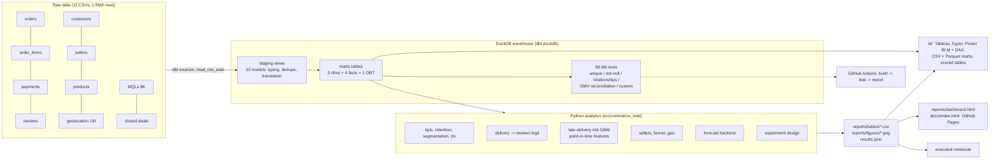

# Architecture

## Layers

| Layer | Tool | What it does |
|---|---|---|
| Ingest | Python `ingest.py` | downloads the 11 CSVs from a public mirror, validates row counts against the published Kaggle dataset |
| Transform | dbt-duckdb (`dbt/`) | 10 staging views -> 10 mart tables (star schema + one-big-table), 59 tests |
| Analyse | Python package (`src/commerce_intel/analytics`) | 12 modules, each `run(con) -> dict` writing CSV tables + PNG figures |
| Query library | `sql/analysis/*.sql` | 13 named business questions in plain SQL (window functions, LOD-style CTEs) |
| Serve | `report.py` | one self-contained HTML dashboard (Plotly), also published to GitHub Pages |
| BI | `bi_export.py` + `bi/` | `.hyper` extract, Power Query + DAX, CSV/Parquet marts with model scores joined on |
| Verify | pytest + dbt tests + CI | data contracts, metric guard-rails, model sanity; `make all` is reproducible |

## Design decisions
- **DuckDB over Postgres/BigQuery**: zero infrastructure, the whole warehouse is a 150 MB file, SQL is ANSI with window functions; dbt-duckdb gives the same lineage/tests you would have in Snowflake.
- **Two grains of customer**: raw `customer_id` is per order; `customer_unique_id` is the person. All retention/CLV work uses the person.
- **Complete-month window**: the extract is right-censored after ~21 Aug 2018, so monthly metrics use Jan-2017..Jul-2018 and the weekly forecast uses weeks to 19 Aug 2018.
- **Point-in-time features**: the late-delivery model computes each seller's historical late rate using only orders delivered before the order being scored, and is evaluated on a forward-in-time split.
- **Honest model reporting**: the repeat-purchase model is kept and reported with its weak AUC because the negative result carries a business message.
